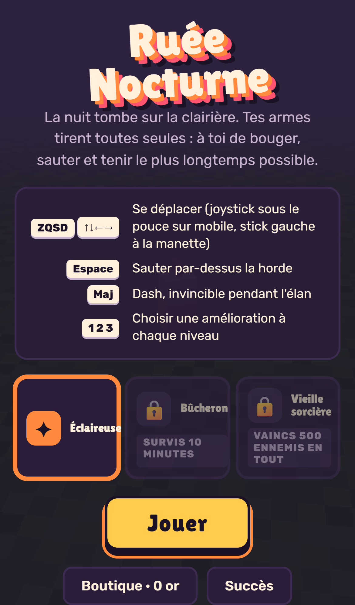
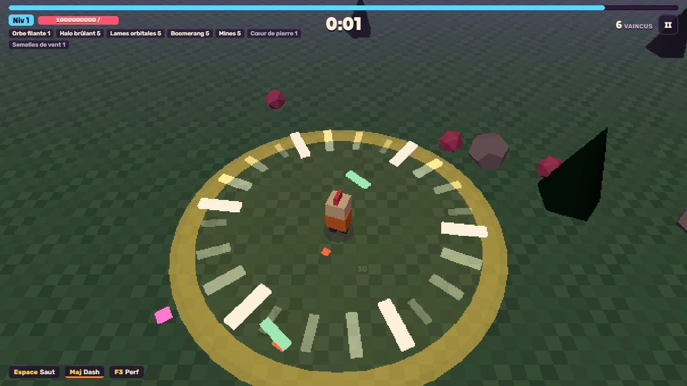

# Ruée Nocturne

Survivor 3D low-poly, jouable sur téléphone et PC, livré en PWA installable et hors ligne. La nuit tombe sur une clairière : tes armes tirent toutes seules, toi tu bouges, tu sautes par-dessus la horde, tu dashes, tu choisis tes améliorations. Tiens 20 minutes.

**Jouer : https://ruee-nocturne.web.app** (français / anglais, Chrome, Edge, Firefox, Safari ; installable sur Android, iPhone et desktop).

| | |
| --- | --- |
|  |  |

## Le jeu

- 6 armes automatiques à la grammaire distincte, 8 passifs, 4 évolutions (arme au niveau 5 + passif + coffre).
- 6 ennemis, 3 boss scriptés (5:00, 10:00, 15:00), le Faucheur à 20:00.
- Saut et dash invincible : la horde se traverse, les Volants plongent, les Colosses télégraphient.
- Méta : or, boutique permanente, 11 succès à barres, 3 personnages, défi du jour, écran de mort qui dit ce qu'il te manquait.
- Sauvegarde locale exportable en JSON ; compte facultatif (Google ou e-mail) pour retrouver sa progression sur un autre appareil. Sans compte, aucune donnée ne quitte l'appareil ([PRIVACY.md](PRIVACY.md)).

## Développer

```bash
npm ci
npm run dev          # Vite, http://localhost:5173
npm test             # Vitest : simulation déterministe (headless), i18n, cartes
npm run test:e2e     # Playwright : fumée WebGL, tactile, relance, langue, captures (sert le build de prod)
npm run sim -- --runs 200 --bot average --seed 42   # équilibrage par simulation, cibles de survivor-design
npm run bench        # 10 s de sim à 400 ennemis : ms/step, allocations (budgets de PLAN.md §4.3)
npm run lh           # Lighthouse mobile, médiane de 3 runs, seuils de la porte de phase 5
npm run build && npm run preview   # tester le service worker (jamais en dev)
```

Node ≥ 22. Aucune dépendance d'exécution hors Three.js et idb-keyval.

## Architecture

- `src/sim/` : simulation pure et déterministe (pas fixe 60 Hz, aucun import de three ni du DOM, aucun texte). Toute constante de jeu est dans `src/sim/balance.ts`.
- `src/render/` : Three.js, lit le monde, n'y écrit jamais ; tout ce qui se répète est instancié. Chargé à part, à la première interaction.
- `src/ui/` : DOM natif (HUD, cartes, écrans de méta). `src/i18n/` : `fr.json`, `en.json`, `t()`.
- `src/platform/` : entrées (clavier, tactile, manette), audio procédural, PWA. `src/meta/` : sauvegarde versionnée, succès, boutique, défi du jour.
- `tools/` : CLI de simulation et bots, bench, icônes, Lighthouse. `e2e/` : Playwright.

La sim émet des événements ; rendu, audio et HUD s'y abonnent, jamais l'inverse. Détail : [PLAN.md](PLAN.md) §4.

## Documents

| Fichier | Rôle |
| --- | --- |
| [PLAN.md](PLAN.md) | Source de vérité : vision, boucles, contenu, architecture, phases et portes |
| [docs/GATES.md](docs/GATES.md) | Portes franchies, mesures réelles, décisions prises |
| [docs/DEVICES.md](docs/DEVICES.md) | Appareils de test, protocole, bugs |
| [docs/DEPLOY.md](docs/DEPLOY.md) | Déploiement Firebase Hosting par GitHub Actions |
| [docs/STACK.md](docs/STACK.md) | Versions et pièges de la pile |
| [CHANGELOG.md](CHANGELOG.md) | Journal des modifications |
| [CREDITS.md](CREDITS.md) · [PRIVACY.md](PRIVACY.md) | Crédits et licences · confidentialité |
| `CLAUDE.md`, `.claude/` | Règles de travail, skills et agents de Claude Code, avec lequel le jeu est écrit |
| `prototype/` | Tout premier prototype, référence historique |

## Licence

Code © Jimmy Haggege. Polices sous SIL Open Font License, bibliothèques sous MIT et Apache-2.0 : voir [CREDITS.md](CREDITS.md).
